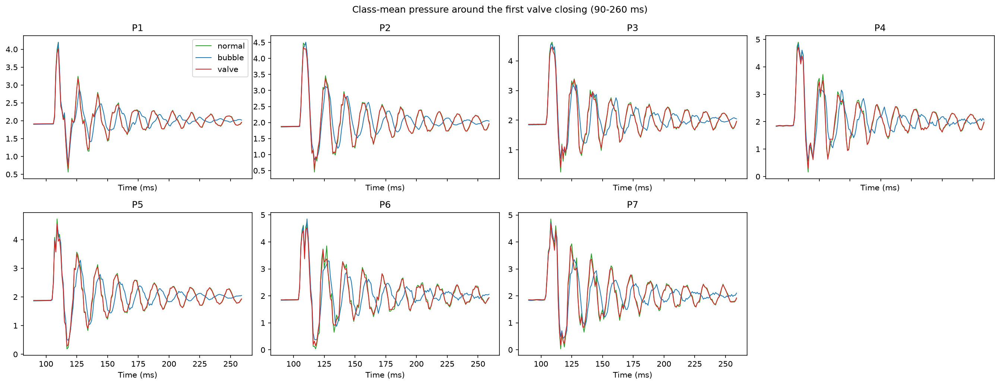

# Fault Diagnosis of a Spacecraft Propulsion System

Course project for **ME F321 – Data Mining in Mechanical Sciences** (BITS Pilani).

From seven pressure signals (P1–P7, 1 kHz, 1200 ms) recorded on a spacecraft propulsion test rig, the project detects
abnormal cases, tells bubble anomalies from solenoid-valve faults, locates the bubble, finds the failed valve and
estimates its opening ratio. The test set includes **spacecraft 4, which never appears in training**, so every model is
chosen for how well it carries over to an unseen spacecraft.



## Tasks

| Task | Question | Type |
|---|---|---|
| 1 | Normal or abnormal? | Binary classification |
| 2 | Bubble anomaly, valve fault or unknown anomaly? | Classification + novelty detection |
| 3 | Where is the bubble? (BV1, BP1–BP7) | 8-class classification |
| 4 | Which solenoid valve failed? (SV1–SV4) | 4-class classification |
| 5 | Opening ratio of the failed valve (%) | Regression |

## Method

1. **Cycle averaging** – the three valve cycles in each case are averaged to cut noise.
2. **Spacecraft residuals** – each signal minus the median signal of its spacecraft. This removes the differences between
   spacecraft and keeps only the fault signature.
3. **Features** – statistics of the raw and residual signals in four physical phases of the valve cycle, plus FFT features.
4. **Leave-One-Spacecraft-Out (LOSO) validation** – train on two spacecraft, test on the third, which mimics the real test.
5. **Models** – Decision Tree, Random Forest, Gradient Boosting, Naive Bayes, SVM, KNN and a Keras neural network.
6. **Novelty detection** – distance to the nearest known cases in PCA space flags anomaly types not seen in training.
7. **Hierarchical prediction** – Task 1 → Task 2 → Task 3, or Tasks 4 and 5.

## Results (LOSO)

| Task | Best model | Score |
|---|---|---|
| 1 Normal / abnormal | Random Forest | Macro F1 = 1.00 |
| 2 Bubble / valve | Random Forest | Macro F1 = 1.00 |
| 3 Bubble location | Random Forest | Macro F1 = 1.00 |
| 4 Failed valve | Random Forest | Macro F1 = 1.00 |
| 5 Opening ratio | Gradient Boosting | MAE = 5.28 % |

With raw features, a random 70/30 split overestimates performance on a new spacecraft (Random Forest, Task 1: 0.98
random vs 0.72 LOSO). The residual features close this gap. The full comparison of all models is in
[`outputs/model_comparison_classification.csv`](outputs/model_comparison_classification.csv) and in Steps 9–15 of the
notebook.

## Repository layout

```
├── MEF321_Project_Solution.ipynb   main notebook: analysis, models, test predictions
├── data/                           dataset goes here (not included, see data/README.md)
├── outputs/
│   ├── Predictions.csv             test-set predictions with a key to the codes
│   ├── submission.csv              test-set predictions, plain format
│   ├── test_predictions_readable.csv
│   ├── model_comparison_*.csv      model scores
│   ├── dashboard.html              interactive Bokeh dashboard
│   └── figures/                    all plots made by the notebook
├── requirements.txt
└── README.md
```

## How to run

```bash
pip install -r requirements.txt
# put the dataset in data/ (see data/README.md)
jupyter notebook MEF321_Project_Solution.ipynb
```

Run all cells. Figures are written to `outputs/figures/` and predictions to `outputs/`.
